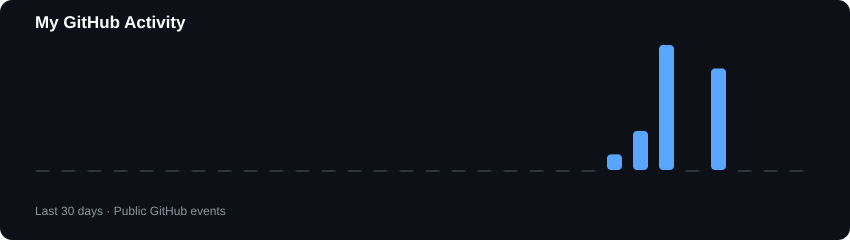

# 👋 Hi, It's Chris\!

### Computer Science Student | Software Developer | Problem Solver

I'm passionate about building applications, exploring AI-driven solutions, and developing my skills across different areas of software engineering.

- 🎓 Studying at Queen Mary University of London
- 💻 Interested in Python, Java, C++ and full-stack development
- 🤖 Exploring AI and backend systems
- 🚀 Always building, learning and experimenting

---

## 📊 My Developer Activity

---

## 🥧 Technologies Across My Projects

## 🛠️ Languages I Work With

- Python
- Java
- C++
- JavaScript
- TypeScript
- HTML & CSS

---

## 🚀 Featured Projects

- [A Mind Reading Digital Marvel](<https://github.com/cpint2410/A-Mind-Reading-Digital-Marvel>)
- [Guessing Games](<https://github.com/cpint2410/Guessing-Games>)
- [Personal Portfolio Website](<https://github.com/cpint2410/Phase1-WebTech>)
- [JPMC Midas Project](<https://github.com/cpint2410/forage-midas>)

---

## 📫 Connect With Me

- [LinkedIn](https://www.linkedin.com/in/chris-pinto-083242388)
- [Portfolio](https://chrispinto.tech/)
- [GitHub](<https://github.com/cpint2410>)
- [X](https://x.com/2410_cpu) _(Twitter)_

⭐ Thanks for visiting my profile\!
