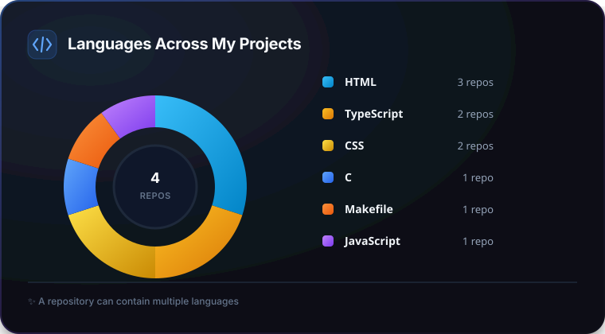

# 👋 Hi, It's Chris!

### Computer Science & Artificial Intelligence Student | Software Developer

Computer Science and Artificial Intelligence student at Queen Mary University of London, interested in software engineering, backend development, databases and AI-driven applications.

I enjoy building practical software solutions, working with complex datasets and developing applications from initial design through to deployment.

- 🎓 BSc Computer Science & Artificial Intelligence — Queen Mary University of London
- 💻 Software development experience across Python, Java, C#, JavaScript and TypeScript
- 🗄️ Experience designing relational databases and migrating large datasets
- 🚀 Interested in backend engineering, cloud technologies and full-stack development

---

## 💼 Professional Experience

### IT Support & Software Development Intern
**River Group Content Ltd | July 2026 – August 2026** ([*](http://therivergroup.co.uk/))

Independently developed and deployed a financial records management application using Python, Flask and PostgreSQL.

**Key achievements:**

- Developed a Python/Flask application providing authenticated access to financial invoice records.
- Migrated approximately **12,000 legacy financial records** into a structured PostgreSQL database.
- Designed a relational database comprising approximately 7–8 related tables.
- Achieved **100% matching during migration validation** against the original source dataset.
- Implemented searchable financial records functionality, including invoice and purchase order searches.
- Integrated PostgreSQL records with SharePoint-hosted invoice documents.
- Implemented authentication using Flask-Login.
- Deployed the application using Render and prepared technical handover documentation.

**Technologies:** Python, Flask, Flask-Login, PostgreSQL, SQL, HTML, CSS, JavaScript, Bootstrap, Microsoft Access, Excel, SharePoint, Render and Git.

**Project confidentiality:** The original application is maintained in a private company repository. A separate public case study documents my individual contributions without exposing proprietary source code or company information.

[View Public Project Case Study](https://github.com/cpint2410/river-group-internship-case-study)

---

## 🚀 Featured Projects

### MailSync — Email Automation SaaS
**C# | .NET | ASP.NET Core | PostgreSQL | Docker**

Developing a containerised productivity platform for email ingestion, processing and transformation.

- Implemented Modular Clean Architecture.
- Developed versioned REST API endpoints.
- Integrated PostgreSQL using Entity Framework Core.
- Implemented asynchronous background email ingestion.
- Configured a multi-container Docker Compose environment.

[View on GitHub](https://github.com/cpint2410/MailSync)

### Full-Stack Expense Tracker
**React | TypeScript | Node.js | Express | PostgreSQL**

Designed and deployed a full-stack personal finance application.

- Developed responsive financial dashboards.
- Implemented income, expense and budget management.
- Integrated PostgreSQL using Drizzle ORM.
- Implemented Firebase authentication.
- Integrated Google Gemini for AI-powered financial insights.

[View on Github](https://github.com/cpint2410/finance-ai-assistant-app)
[Live Demo](https://full-stack-expense-tracker-3trd.onrender.com/)

### Linux Process Monitor
**C | Linux | POSIX | GCC**

Developed a Linux process monitoring utility using the `/proc` filesystem.

- Implemented process discovery and CPU utilisation calculations.
- Developed system and process memory monitoring.
- Implemented interactive terminal controls.
- Applied systems programming and memory management concepts.

[View on Github](https://github.com/cpint2410/linux-process-monitor)

### AI Financial Investment Assistant
**Python | Streamlit | pandas | NumPy | AI**

Developing an application for investment portfolio analysis and financial risk assessment.

- Integrated Alpha Vantage and yfinance.
- Implemented portfolio performance and risk metrics.
- Developed interactive Streamlit dashboards.
- Integrated Google Gemini for natural-language financial explanations.

### Additional Projects
- [JPMC Midas Project](https://github.com/cpint2410/forage-midas)

---

## 🏆 Academic Achievements

**Queen Mary University of London**

- First-class results in completed first-year modules.
- Recognised among the **Top 10** students in ECS414U through the Level Up Awards 2026.
- Excellent Understanding of Academic Integrity Award.

---

## 📊 GitHub Activity

---

## 🛠️ Technical Skills

**Languages**
Python · Java · C · C# · JavaScript · TypeScript · SQL · HTML · CSS

**Backend & Frameworks**
Flask · ASP.NET Core · Node.js · Express · React · Streamlit

**Databases**
PostgreSQL · Microsoft Access · Entity Framework Core · Drizzle ORM

**Cloud & DevOps**
Docker · Docker Compose · Render · Git · GitHub

**Data & AI**
pandas · NumPy · Alpha Vantage · yfinance · Google Gemini API · LangChain

**Software Engineering**
REST APIs · Object-Oriented Programming · Clean Architecture ·
Database Design · Data Migration · Testing · Debugging

---

## 📫 Connect With Me

- 💼 [LinkedIn](https://www.linkedin.com/in/chris-pinto-083242388)
- 🌐 [Portfolio](https://chrispinto.tech/)
- 🐙 [GitHub](https://github.com/cpint2410)
- ✉️ chrispinto.work@gmail.com
- 𝕏 [X / Twitter](https://x.com/2410_cpu)

---
